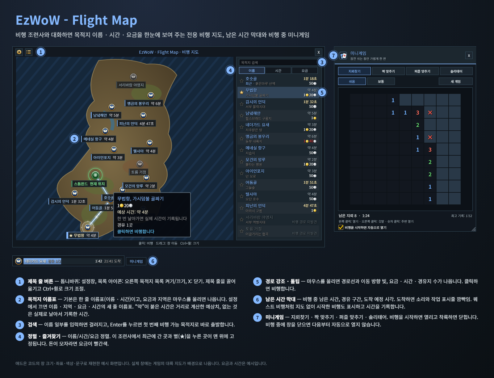
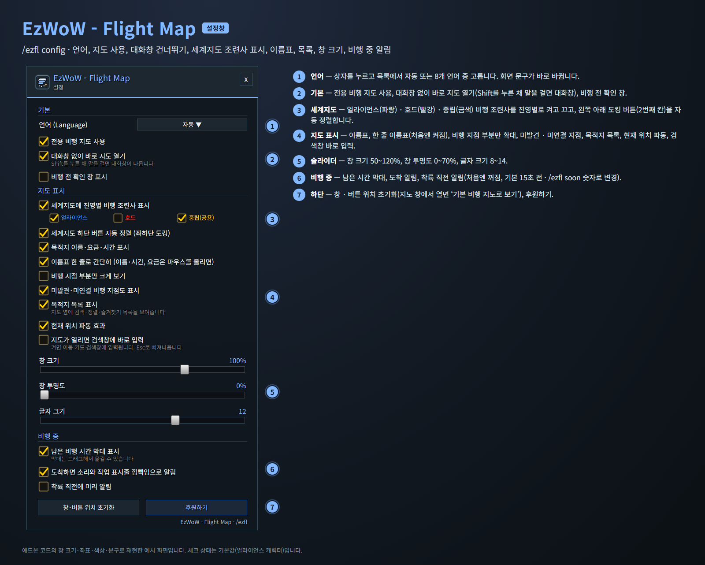
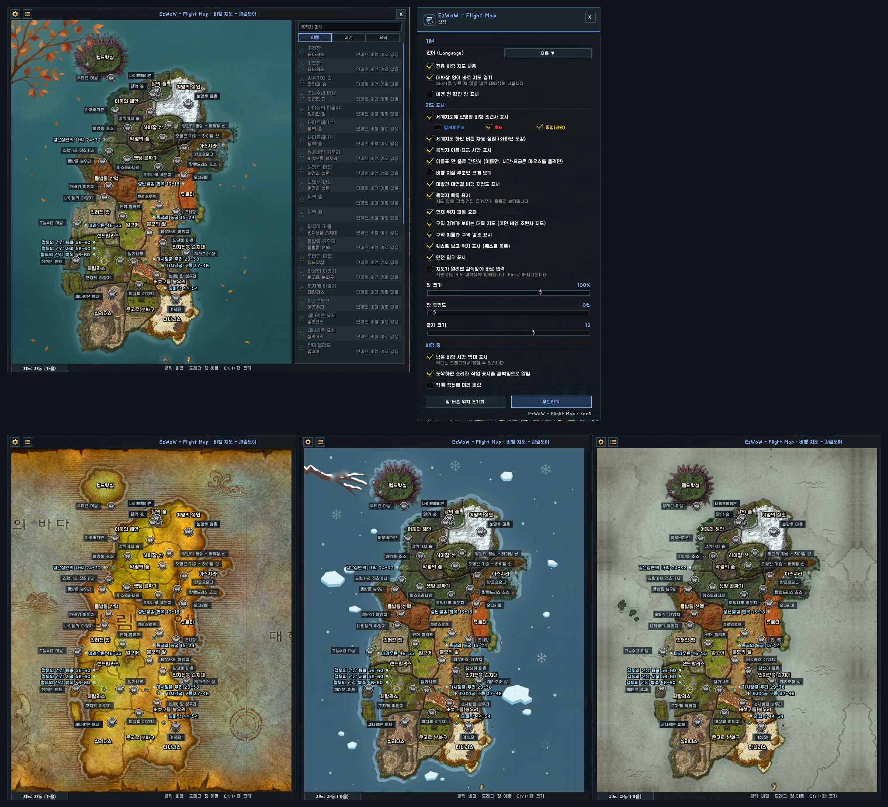
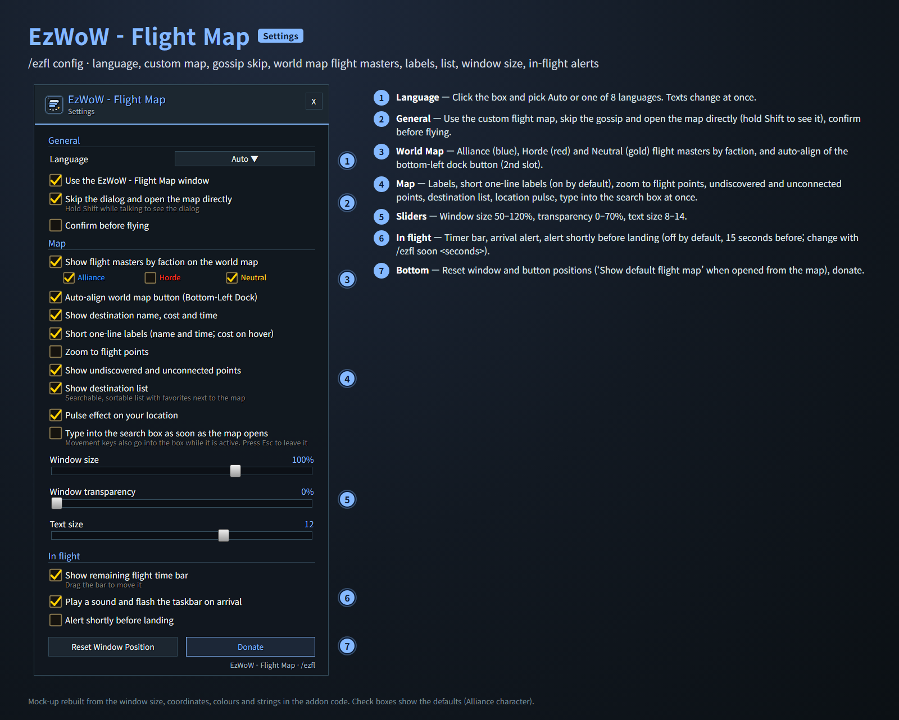

# EzWoW - Flight Map (`EzWoW-FlightMap`)

## CurseForge

- **Project ID / 프로젝트 ID:** `1736991`
- **Project page / 프로젝트 페이지:** [EzWoW-FlightMap](https://www.curseforge.com/wow/addons/easyflightmap)

**[한국어](#한국어) · [English](#english)**

WoW Forever (`Interface: 16001`) · `/ezfl` · `/미니게임`

---

## 한국어

### 개요

비행 조련사(그리폰·와이번·박쥐·히포그리프)와 대화하면 기본 비행 지도 대신 **전용 비행 지도**를 엽니다. 목적지마다 **이름 · 소요 시간**을 한 줄 이름표로 보여 주고(요금·지역은 마우스를 올리면 표시, 설정에서 세 줄 이름표로 바꿀 수 있음), 마우스를 올리면 비행 경로가 강조됩니다. 오른쪽 목적지 목록에서 검색·정렬·즐겨찾기를 할 수 있고, 비행 중에는 남은 시간 막대와 미니게임을, 세계지도에는 진영별 비행 조련사 위치를 보여 줍니다.

> 자세한 사용 설명서: [한국어](docs/USER_GUIDE-koKR.md) · [English](docs/USER_GUIDE-enUS.md)

### 화면 미리보기

> 이미지는 애드온 코드의 창 크기·좌표·색상·문구로 재현한 **예시 화면**입니다. 실제 창에는 게임의 대륙 지도가 배경으로 나옵니다. 요금과 시간은 예시입니다.

### 설치

1. `EzWoW-FlightMap` 폴더를 `Interface/AddOns/` 폴더에 넣습니다.
2. 캐릭터 선택 화면의 **애드온** 목록에서 켭니다.
3. 비행 조련사에게 말을 걸면 전용 지도가 열립니다. 설정은 `/ezfl`.

### 비행 지도 사용법 (위 그림의 번호)

| 번호 | 부분 | 설명 |
|---|---|---|
| ① | 제목 줄 버튼 | 톱니바퀴: 설정창, 목록 아이콘: 오른쪽 목적지 목록 켜기/끄기, X: 닫기. 제목 줄을 끌어 창을 옮기고 **Ctrl + 마우스 휠**로 크기를 바꿉니다. |
| ② | 목적지 이름표 | 기본은 비행 지점 바로 아래의 **한 줄 이름표**(이름 · 소요 시간)입니다. 요금과 지역은 마우스를 올리면 툴팁에 나오고, 마우스를 올린 이름표는 겹친 이름표보다 앞으로 나옵니다. 설정에서 **이름표 한 줄로 간단히**를 끄면 이름 · 지역 · 요금(금·은·동) · 소요 시간의 세 줄 이름표가 서로 겹치지 않게 자동 배치됩니다. 현재 위치는 초록색으로 표시됩니다. |
| ③ | 검색 | 이름 일부를 입력하면 목록이 걸러집니다. **Enter**를 누르면 첫 번째 비행 가능 목적지로 바로 출발합니다. |
| ④ | 정렬 · 즐겨찾기 | 이름/시간/요금 정렬. 별(★)을 누르면 즐겨찾기가 되고, 즐겨찾기와 이 조련사에서 **최근** 간 곳은 맨 위에 고정됩니다. 소지금보다 비싼 곳은 빨간색입니다. |
| ⑤ | 경로 강조 · 툴팁 | 목적지에 마우스를 올리면 경로선과 이동 방향 빛 애니메이션, 경유지 수, 요금, 시간이 나옵니다. 클릭하면 비행합니다. |
| ⑥ | 남은 시간 막대 | 비행 중 남은 시간, 경유 구간(경유 1/2), 도착 예정 시각을 보여 줍니다. 도착하면 소리와 작업 표시줄 깜빡임으로 알려 줍니다. 막대는 끌어서 옮길 수 있고, 비행 중에 `/reload`하거나 다시 접속해도 이어서 표시됩니다. 막대 오른쪽의 **미니게임** 버튼으로 미니게임 창을 엽니다. 퀘스트 비행처럼 비행 지도를 거치지 않고 시작한 비행도 `비행 중`으로 표시하고, 걸린 시간을 출발 위치별로 기록해 다음에는 남은 시간을 보여 줍니다. |
| ⑦ | 미니게임 창 | 비행을 시작하면 자동으로 열립니다. 아래 [미니게임](#미니게임-미니게임-ezgames) 참고. |

#### 요금 · 시간 표기

| 표시 | 뜻 |
|---|---|
| 금·은·동 숫자 | 게임에서 확인한 현재 요금 |
| `무료` / `미확인` | 요금이 0인 경로 / 요금을 확인할 수 없는 경로 |
| `약 4분` | 구간 거리(`Data/RouteDistances.lua`)와 비행 속도로 계산한 **예상 시간**(분 단위) |
| `1분 28초` (`약` 없음) | 그 경로를 실제로 날아서 **기록한 시간** |
| `미측정` | 기록도, 계산용 거리 데이터도 없는 경로 |

- 기본 설정에서는 조련사 대화창을 건너뛰고 바로 지도를 엽니다. **Shift**를 누른 채 말을 걸면 대화창이 나옵니다.
- 세계지도 왼쪽 아래 **2번째 도킹 버튼**을 누르면 얼라이언스(파랑) · 호드(빨강) · 중립(금색) 비행 조련사 표시를 진영별로 켜고 끌 수 있습니다.

### 설정창 (`/ezfl config`)

| 번호 | 항목 | 설명 | 기본값 |
|---|---|---|---|
| ① | 언어 (Language) | 상자를 누르고 목록에서 자동 또는 8개 언어 중 고름. 화면 문구가 바로 바뀝니다. | 자동 |
| ② | 전용 비행 지도 사용 | 끄면 게임 기본 비행 지도를 씁니다. | 켬 |
| ② | 대화창 없이 바로 지도 열기 | Shift를 누른 채 말을 걸면 대화창이 나옵니다. | 켬 |
| ② | 비행 전 확인 창 표시 | 출발 전에 요금·목적지를 한 번 더 확인 | 끔 |
| ③ | 세계지도에 진영별 비행 조련사 표시 | 얼라이언스 / 호드 / 중립 각각 선택 | 켬 |
| ③ | 세계지도 하단 버튼 자동 정렬 | 좌하단 도킹 | 켬 |
| ④ | 목적지 이름·요금·시간 표시 | 지도 이름표 | 켬 |
| ④ | 이름표 한 줄로 간단히 (이름·시간, 요금은 마우스를 올리면) | 끄면 이름·지역·요금·시간의 세 줄 이름표 | 켬 |
| ④ | 비행 지점 부분만 크게 보기 | 비행 지점이 있는 부분만 확대 | 끔 |
| ④ | 미발견·미연결 비행 지점도 표시 | 흐린 아이콘으로 표시 | 켬 |
| ④ | 목적지 목록 표시 | 검색·정렬·즐겨찾기 목록 | 켬 |
| ④ | 현재 위치 파동 효과 | 현재 위치 강조 | 켬 |
| ④ | 지도가 열리면 검색창에 바로 입력 | 켜면 이동 키도 검색창에 입력됩니다(Esc로 빠져나옴). | 끔 |
| ⑤ | 창 크기 · 창 투명도 · 글자 크기 | 50~120% · 0~70% · 8~14 | 100% · 0% · 12 |
| ⑥ | 남은 비행 시간 막대 표시 | 비행 타이머 막대 | 켬 |
| ⑥ | 도착하면 소리와 작업 표시줄 깜빡임으로 알림 | 도착 알림 | 켬 |
| ⑥ | 착륙 직전에 미리 알림 | 예상 비행 시간 기준으로 착륙 몇 초 전(기본 15초)에 소리와 채팅 메시지로 알림. `/ezfl soon 숫자`로 초 변경 | 끔 |
| ⑦ | 창·버튼 위치 초기화 / 후원하기 | 지도 창·막대·세계지도 버튼 위치와 크기 초기화. 비행 지도가 열린 상태에서는 이 버튼이 **기본 비행 지도로 보기**로 바뀝니다. | - |

### 미니게임 (`/미니게임`, `/ezgames`)

비행하는 동안 가볍게 즐길 수 있는 **지뢰찾기 · 짝 맞추기 · 퍼즐 맞추기 · 솔리테어**가 들어 있습니다.

- 비행을 시작하면 미니게임 창이 자동으로 열리고, 착륙하면 닫힙니다. 게임을 하는 중이면 착륙해도 닫히지 않습니다.
- 창 아래 **비행을 시작하면 자동으로 열기**를 끄면 자동으로 열리지 않습니다. 자동으로 열린 창을 비행 중에 직접 닫아도 이 설정이 꺼지고 채팅창에 안내가 나옵니다. 다시 켜려면 이 칸을 선택합니다.
- 언제든 `/미니게임` 또는 `/ezgames`, 또는 남은 시간 막대 오른쪽의 **미니게임** 버튼으로 열고 닫을 수 있습니다.
- 게임마다 난이도를 고를 수 있고, 최고 기록과 진행 중인 판이 저장되어 `/reload`나 다시 접속한 뒤에도 이어서 할 수 있습니다.
- 창 오른쪽 아래 모서리를 끌거나 **Ctrl + 마우스 휠**로 크기를 바꿉니다.

### 명령어 (`/ezfl`, `/efm`, `/ezwowflightmap`, `/비행지도`)

| 명령어 | 설명 |
|---|---|
| `/ezfl` (`config`) | 설정창 열기 |
| `/ezfl on` · `/ezfl off` | 전용 비행 지도 켜기 · 끄기 |
| `/ezfl skip` | 대화창 건너뛰기 켜기/끄기 |
| `/ezfl labels` · `/ezfl list` · `/ezfl all` · `/ezfl crop` | 이름표 · 목적지 목록 · 미발견 지점 · 확대 보기 켜기/끄기 |
| `/ezfl bar` · `/ezfl alert` | 남은 시간 막대 · 도착 알림 켜기/끄기 |
| `/ezfl soon` · `/ezfl soon 5~120` | 착륙 직전 알림 켜기/끄기 · 몇 초 전에 알릴지 설정 |
| `/미니게임` · `/ezgames` | 미니게임 창 열기/닫기 |
| `/ezfl scale 50~120` · `/ezfl alpha 0~70` | 창 크기(%) · 창 투명도(%) |
| `/ezfl reset` | 창 위치·크기 초기화 |
| `/ezfl lang <auto\|ko\|en\|de\|fr\|es\|ru\|zhcn\|zhtw>` | 표시 언어 변경 |
| `/ezfl donate` | 후원 주소 보기 |

### 저장 데이터

- `EzWoW_FlightMapDB`: 설정, 즐겨찾기, 최근 목적지, 실측 비행 시간(비행 지도를 거치지 않은 비행 포함), 창 위치, 진행 중인 비행, 미니게임 기록과 진행 중인 판.

<!-- ezwow-pad-share -->
### 게임패드
- 게임패드 UI를 켜면 EzWoW 창을 패드로 다룰 수 있습니다. 방향키로 이동, A(✕)로 누르기, X(□)로 오른쪽 클릭, LB/RB로 스크롤, B(○)로 닫기입니다. 창 아래에 연결된 패드 모양으로 키 안내가 나옵니다.
- 블리자드 창이 열려 있지 않을 때 **보기(Back) / Create 버튼**을 누르면 화면의 EzWoW 프레임(유틸리티 바, 퀘스트 목록 등)으로 이동합니다. 다시 누르거나 B를 누르면 돌아갑니다.
- 세계지도에서는 보기 / Create 버튼으로 왼쪽 아래 EzWoW 아이콘에 갑니다.
- 다른 버튼을 쓰려면 설정 > 단축키 > 애드온 > EzWoW > "게임패드: EzWoW 창으로 이동/돌아가기"에 지정합니다(EzWoW-MapFinder가 설치돼 있을 때).

### 기록 공유
- 모든 EzWoW 애드온이 함께 쓰는 기록 공유가 **기본으로 켜져 있습니다**. 직접 확인한 퀘스트 NPC, 희귀 몬스터 목격, 아이템 드롭, 채집 위치를 다른 EzWoW 사용자와 나눕니다.
- `/ezshare` 또는 `/공유`: `on` / `off` 켜기·끄기, `channel on` / `channel off` 서버 채널 사용, `status` 현재 상태와 기록 수.

---

## English

### Overview

When you talk to a flight master (gryphon, wyvern, bat or hippogryph), Flight Map opens a **dedicated flight map** instead of the default one. Each destination gets a short one-line label with **name · flight time** (fare and zone show on hover; a three-line label is available in the settings), and hovering highlights the route. The list on the right supports search, sorting and favourites; during the flight a timer bar shows the remaining time and mini games keep you busy, and the World Map can show flight masters by faction.

> Full user guide: [한국어](docs/USER_GUIDE-koKR.md) · [English](docs/USER_GUIDE-enUS.md)

### Screenshots

> These are **mock-ups** rebuilt from the window sizes, coordinates, colours and strings in the code. In game the continent map art is shown in the background. Fares and times are examples.

### Installation

1. Copy the `EzWoW-FlightMap` folder into `Interface/AddOns/`.
2. Enable it in the **AddOns** list on the character select screen.
3. Talk to a flight master to open the map. Settings: `/ezfl`.

### Using the flight map (numbers in the picture)

| No. | Part | Description |
|---|---|---|
| ① | Title buttons | Gear: settings, list icon: toggle the destination list, X: close. Drag the title to move, **Ctrl + mouse wheel** to resize. |
| ② | Destination labels | By default a **one-line label** (name · flight time) right under each flight point. Fare and zone show in the tooltip on hover, and the hovered label comes to the front of any it overlaps. Untick **Short one-line labels** in the settings for three-line labels (name · zone · fare (g/s/c) · time) that are placed so they do not overlap. Your current location is green. |
| ③ | Search | Type part of a name to filter. **Enter** flies to the first reachable result. |
| ④ | Sort · favourites | Sort by name, time or fare. Click the star (★) to favourite; favourites and the **Recent** destination for this flight master stay on top. Destinations you cannot afford are red. |
| ⑤ | Route highlight · tooltip | Hover a destination to see the path with a moving light, number of stops, fare and time. Click to fly. |
| ⑥ | Flight timer bar | Time left, current leg (stop 1/2) and arrival clock time. Plays a sound and flashes the taskbar on arrival. Drag the bar to move it; it comes back after a `/reload` or reconnect during the flight. The **Mini Games** button on the right of the bar opens the mini games window. Flights that start without the flight map, such as quest flights, show as `Flying`; their time is recorded per starting place and shown as time left next time. |
| ⑦ | Mini games window | Opens by itself when a flight starts. See [Mini games](#mini-games-ezgames-미니게임) below. |

#### Fare and time notation

| Shown as | Meaning |
|---|---|
| g/s/c amount | Current fare from the game |
| `Free` / `Unknown` | Zero-cost route / fare not readable |
| `~4m` | **Estimate** from route distance (`Data/RouteDistances.lua`) and flight speed, in whole minutes |
| `1m 28s` (no `~`) | **Recorded** time from actually flying that route |
| `Not recorded` | No recorded time and no distance data |

- By default the gossip window is skipped and the map opens at once. Hold **Shift** while talking to see the gossip.
- The **2nd dock button** at the bottom-left of the World Map toggles Alliance (blue), Horde (red) and Neutral (gold) flight masters separately.

### Settings window (`/ezfl config`)

| No. | Option | Description | Default |
|---|---|---|---|
| ① | Language | Click the box and pick Auto or one of 8 languages from the list. Texts change at once. | Auto |
| ② | Use the EzWoW - Flight Map window | Off = use the default flight map | On |
| ② | Skip the dialog and open the map directly | Hold Shift while talking to see the dialog | On |
| ② | Confirm before flying | Confirm fare and destination before take-off | Off |
| ③ | Show flight masters by faction on the world map | Alliance / Horde / Neutral individually | On |
| ③ | Auto-align world map button (Bottom-Left Dock) | Dock alignment | On |
| ④ | Show destination name, cost and time | Map labels | On |
| ④ | Short one-line labels (name and time; cost on hover) | Off = three-line labels with name, zone, fare and time | On |
| ④ | Zoom to flight points | Zoom into the area that has flight points | Off |
| ④ | Show undiscovered and unconnected points | Shown as faded icons | On |
| ④ | Show destination list | Search / sort / favourites list | On |
| ④ | Pulse effect on your location | Highlights where you are | On |
| ④ | Type into the search box as soon as the map opens | Movement keys type into the box while active (Esc leaves) | Off |
| ⑤ | Window size · Window transparency · Text size | 50–120% · 0–70% · 8–14 | 100% · 0% · 12 |
| ⑥ | Show remaining flight time bar | Flight timer bar | On |
| ⑥ | Play a sound and flash the taskbar on arrival | Arrival alert | On |
| ⑥ | Alert shortly before landing | Sound and chat message a few seconds (15 by default) before the estimated landing. Change the seconds with `/ezfl soon <seconds>` | Off |
| ⑦ | Reset Window Position / Donate | Resets map window, bar and World Map button positions and size. While the flight map is open this button reads **Show default flight map**. | - |

### Mini games (`/ezgames`, `/미니게임`)

**Minesweeper · Memory · Sliding Puzzle · Solitaire** to pass the time while flying.

- The mini games window opens by itself when a flight starts and closes on landing, unless a game is still being played.
- Untick **Open when a flight starts** at the bottom of the window to stop this. Closing the window yourself while it is open on a flight also turns this off, with a note in chat; tick the box to turn it back on.
- Open or close it at any time with `/ezgames` (`/미니게임`) or the **Mini Games** button on the right of the flight timer bar.
- Each game has difficulty levels; best times and unfinished boards are saved, so you can carry on after a `/reload` or relog.
- Drag the bottom-right corner or use **Ctrl + mouse wheel** to resize the window.

### Slash commands (`/ezfl`, `/efm`, `/ezwowflightmap`, `/비행지도`)

| Command | Description |
|---|---|
| `/ezfl` (`config`) | Open settings |
| `/ezfl on` · `/ezfl off` | Enable · disable the custom map |
| `/ezfl skip` | Toggle gossip skipping |
| `/ezfl labels` · `/ezfl list` · `/ezfl all` · `/ezfl crop` | Toggle labels · list · undiscovered points · zoom |
| `/ezfl bar` · `/ezfl alert` | Toggle timer bar · arrival alert |
| `/ezfl soon` · `/ezfl soon 5-120` | Toggle the arriving-soon alert · set how many seconds before landing |
| `/ezgames` · `/미니게임` | Open or close the mini games window |
| `/ezfl scale 50-120` · `/ezfl alpha 0-70` | Window size (%) · transparency (%) |
| `/ezfl reset` | Reset window position and size |
| `/ezfl lang <auto\|ko\|en\|de\|fr\|es\|ru\|zhcn\|zhtw>` | Change display language |
| `/ezfl donate` | Show the support link |

### Saved data

- `EzWoW_FlightMapDB`: settings, favourites, recent destinations, recorded flight times (including flights started without the flight map), window positions, the flight in progress, mini game records and unfinished boards.

### Gamepad
- With the gamepad UI on, EzWoW windows work with a gamepad: D-pad to move, A (✕) to press, X (□) for right-click, LB/RB to scroll, B (○) to close. A key guide in your pad's button style shows under the window.
- With no game window open, press **View (Back) / Create** to move to the EzWoW frames on screen (Utility Bar, quest list and more). Press it again or B to go back.
- On the World Map, View / Create moves to the EzWoW icons at the bottom left.
- To use another button, set Key Bindings > AddOns > EzWoW > "Gamepad: move to / leave the EzWoW frames" (with EzWoW-MapFinder installed).

### Record sharing
- Record sharing, used by all EzWoW addons, is **on by default**. Quest NPCs, rare monster sightings, item drops and gathering spots you have seen yourself are shared with other EzWoW users.
- `/ezshare`: `on` / `off` to turn it on or off, `channel on` / `channel off` for the server channel, `status` for the current state and record counts.

---

## Support / 후원

If you find this addon useful, you can support its development.

애드온이 도움이 되셨다면 개발 후원으로 응원해 주세요.

[Buy Me a Coffee ☕](https://buymeacoffee.com/qqhrqqhr2)

