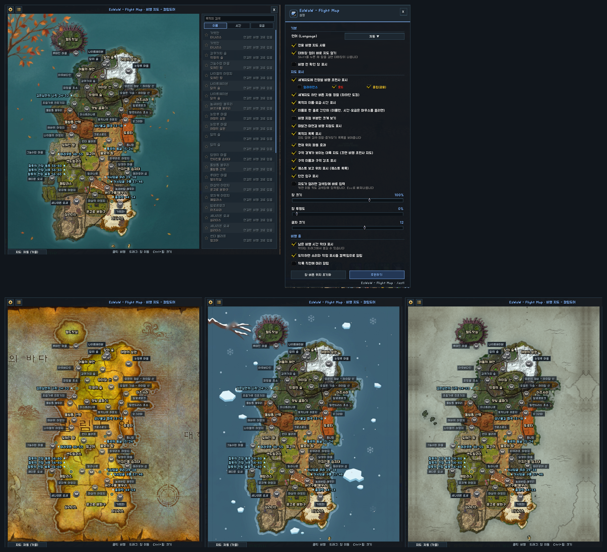
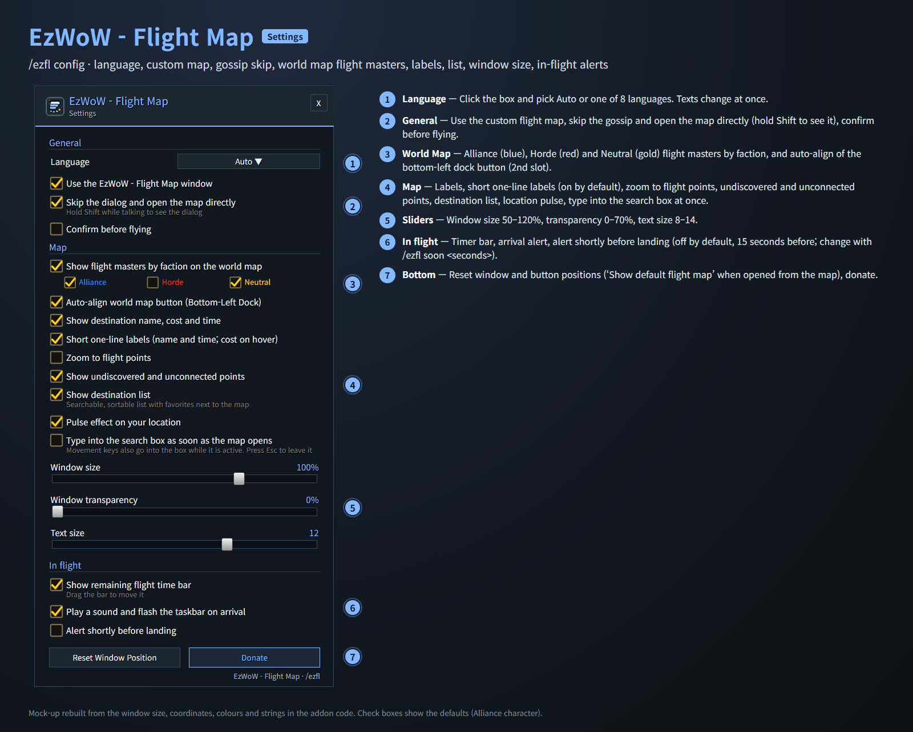
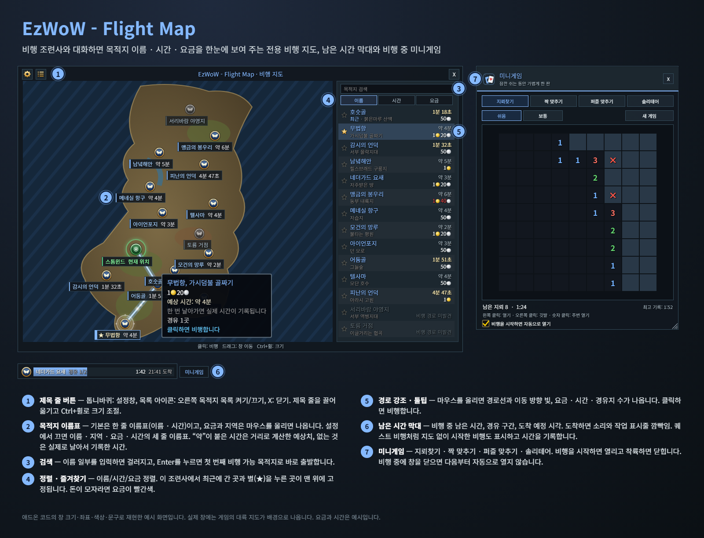
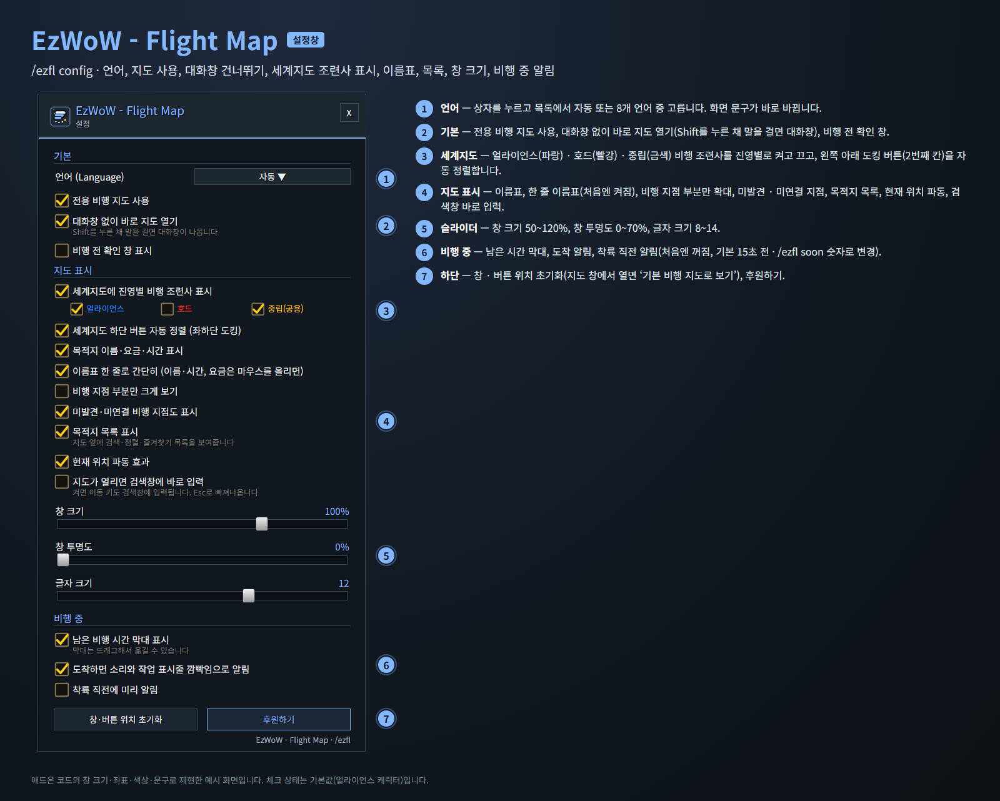

<!--
CurseForge summary (EN): A clean, dedicated flight map with destination names, flight times and fares, a destination list with search and favourites, a flight timer bar, flight masters on the World Map and mini games for the ride.
CurseForge summary (KO): 목적지 이름·소요 시간·요금을 보여 주는 깔끔한 전용 비행 지도, 검색·즐겨찾기 목적지 목록, 남은 비행 시간 막대, 세계지도 비행 조련사 표시, 비행 중 미니게임.
-->

# EzWoW - Flight Map

**English** · [한국어](#한국어)

When you talk to a flight master (gryphon, wyvern, bat or hippogryph), a dedicated flight map opens instead of the default one for WoW Forever. Every destination shows its name and flight time, the route lights up when you hover it, and a list next to the map lets you search, sort and keep favourites. While you fly, a timer bar counts down to landing and a small mini games window keeps you company.

*Mock-ups rebuilt from the window sizes, coordinates, colours and strings in the addon code. In game the continent map art is shown in the background; fares and times are examples.*

## Features

### Flight map
- Opens straight away when you talk to a flight master (hold **Shift** to see the gossip window instead).
- Short one-line labels under each flight point: name and flight time. Fare and zone show on hover. Prefer more detail? Switch to three-line labels with name, zone, fare and time.
- Hover a destination to see the route with a moving light, the fare, the flight time and the number of stops. Click to fly, or turn on a confirmation window first.
- Your current location is green with a pulse; undiscovered and unconnected points are shown faded (optional).
- Drag the title to move the window, **Ctrl + mouse wheel** to resize. Option to zoom into the area that has flight points.

### Map look
- Starts with the game's own continent map. The map button under the map switches to **Auto** (changes with the month), **Spring**, **Summer**, **Autumn**, **Winter** or **Parchment**.
- The seasonal maps show the real terrain with a seasonal sea and a corner decoration, with petals, glints, leaves or snow drifting gently over the map.
- Zone names in your game language with a zone highlight, dungeon entrances with level ranges, and quest turn-in spots for your quest log. Click a marker to pick the nearest flight point.

### Destination list
- Search by part of a name; **Enter** flies to the first reachable result.
- Sort by name, time or fare. Star (★) favourites, and the place you last flew to from this flight master, stay on top.
- Fares you cannot afford are shown in red.

### Flight times
- Times with `~` are estimates from the route distance and flight speed. After you fly a route once, the real time is recorded and shown without `~`.

### Flight timer bar
- Time left, current leg (stop 1/2) and arrival time. A sound and a taskbar flash on arrival, and an optional alert a few seconds before landing.
- Flights started without the flight map, such as quest flights, are shown and timed too.
- Drag to move. It carries on after a `/reload` or reconnect during the flight.

### Mini games
- Minesweeper, Memory, Sliding Puzzle and Solitaire, with difficulty levels, best times and saved boards.
- Opens when a flight starts and closes on landing. Close it during a flight (or untick the box at the bottom) and it stops opening by itself.
- `/ezgames`, or the **Mini Games** button next to the timer bar. Resize by dragging the corner or with Ctrl + mouse wheel.

### World Map
- Alliance (blue), Horde (red) and Neutral (gold) flight masters on the World Map and continent maps, each faction on or off, from a button docked at the bottom-left of the map.

## Gamepad
- With the gamepad UI on, EzWoW windows work with a gamepad: D-pad to move, A (✕) to press, X (□) for right-click, LB/RB to scroll, B (○) to close. A key guide in your pad's button style shows under the window.
- With no game window open, press **View (Back) / Create** to move to the EzWoW frames on screen. Press it again or B to go back.
- On the World Map, View / Create moves to the EzWoW icons at the bottom left.
- To use another button: Key Bindings > AddOns > EzWoW > "Gamepad: move to / leave the EzWoW frames" (with EzWoW-MapFinder installed).

## Record sharing
- Shared by all EzWoW addons and **on by default**: quest NPCs, rare monster sightings, item drops and gathering spots you have seen yourself are shared with other EzWoW users.
- `/ezshare on` / `off`, `/ezshare channel on` / `off`, `/ezshare status`

## Commands
- `/ezfl` (`/efm`, `/비행지도`) — open the settings
- `/ezfl on` · `/ezfl off` — use or stop using the dedicated flight map
- `/ezfl skip` · `labels` · `list` · `all` · `crop` — toggle gossip skipping, labels, the list, undiscovered points, zoom
- `/ezfl bar` · `alert` · `soon [5-120]` — toggle the timer bar, arrival alert, landing-soon alert (and its seconds)
- `/ezfl scale 50-120` · `alpha 0-70` · `reset` — window size, transparency, reset positions
- `/ezfl lang <auto|ko|en|de|fr|es|ru|zhcn|zhtw>` — display language
- `/ezfl season <plain|auto|spring|summer|autumn|winter|parchment>` · `fx` — map look, season effects on/off
- `/ezfl edit` · `edit reset` — move labels by hand, restore default spots
- `/ezgames` (`/미니게임`) — open or close the mini games

Languages: English, 한국어, Deutsch, Français, Español, Русский, 简体中文, 繁體中文.

---

## 한국어

비행 조련사(그리폰·와이번·박쥐·히포그리프)와 대화하면 WoW Forever의 기본 비행 지도 대신 전용 비행 지도를 엽니다. 목적지마다 이름과 소요 시간을 보여 주고, 마우스를 올리면 비행 경로가 강조되며, 지도 옆 목록에서 검색·정렬·즐겨찾기를 할 수 있습니다. 비행 중에는 남은 시간 막대와 작은 미니게임 창이 함께합니다.

*애드온 코드의 창 크기·좌표·색상·문구로 재현한 예시 화면입니다. 실제 창에는 게임의 대륙 지도가 배경으로 나오며, 요금과 시간은 예시입니다.*

## 기능

### 비행 지도
- 비행 조련사에게 말을 걸면 바로 열립니다(**Shift**를 누른 채 말을 걸면 대화창).
- 비행 지점 아래에 한 줄 이름표(이름 · 소요 시간). 요금과 지역은 마우스를 올리면 나옵니다. 설정에서 이름 · 지역 · 요금 · 시간의 세 줄 이름표로 바꿀 수 있습니다.
- 목적지에 마우스를 올리면 경로선과 이동 방향 빛, 요금, 소요 시간, 경유지 수가 나옵니다. 클릭하면 비행하고, 출발 전 확인 창을 켤 수도 있습니다.
- 현재 위치는 초록색과 파동으로, 미발견·미연결 지점은 흐리게 표시합니다(선택).
- 제목 줄을 끌어 이동, **Ctrl + 마우스 휠**로 크기 조절. 비행 지점이 있는 부분만 크게 보는 옵션.

### 지도 모양
- 처음에는 게임 세계 지도의 대륙 그림을 씁니다. 지도 아래 버튼으로 **자동**(달마다 계절), **봄**, **여름**, **가을**, **겨울**, **양피지**로 바꿀 수 있습니다.
- 계절 지도는 실제 지형에 계절 바다와 모서리 장식을 그리고, 꽃잎 · 반짝임 · 낙엽 · 눈이 은은하게 날립니다.
- 게임 언어의 지역 이름과 지역 강조, 던전 입구와 권장 레벨, 퀘스트 목록의 보고 위치를 지도에 표시합니다. 표시를 누르면 가장 가까운 비행 지점을 골라 줍니다.

### 목적지 목록
- 이름 일부로 검색하고 **Enter**를 누르면 첫 번째 비행 가능 목적지로 출발합니다.
- 이름/시간/요금 정렬. 별(★)을 누른 곳과 이 조련사에서 최근에 간 곳이 맨 위에 고정됩니다.
- 소지금보다 비싼 요금은 빨간색입니다.

### 소요 시간
- `약 4분`처럼 `약`이 붙은 시간은 구간 거리와 비행 속도로 계산한 예상 시간입니다. 한 번 날아가면 실제 시간이 기록되어 `약` 없이 표시됩니다.

### 남은 시간 막대
- 남은 시간, 경유 구간(경유 1/2), 도착 예정 시각. 도착하면 소리와 작업 표시줄 깜빡임으로 알리고, 착륙 몇 초 전 알림도 켤 수 있습니다.
- 퀘스트 비행처럼 비행 지도를 거치지 않고 시작한 비행도 표시하고 시간을 기록합니다.
- 끌어서 옮길 수 있고, 비행 중에 `/reload`하거나 다시 접속해도 이어서 표시됩니다.

### 미니게임
- 지뢰찾기, 짝 맞추기, 퍼즐 맞추기, 솔리테어. 난이도 선택, 최고 기록, 진행 중인 판 저장.
- 비행을 시작하면 열리고 착륙하면 닫힙니다. 비행 중에 창을 닫거나 창 아래 칸을 끄면 다음부터 자동으로 열지 않습니다.
- `/미니게임` 또는 남은 시간 막대 옆 **미니게임** 버튼. 모서리를 끌거나 Ctrl + 마우스 휠로 크기 조절.

### 세계지도
- 세계지도와 대륙 지도에 얼라이언스(파랑) · 호드(빨강) · 중립(금색) 비행 조련사를 표시하고, 지도 왼쪽 아래 도킹 버튼에서 진영별로 켜고 끕니다.

## 게임패드
- 게임패드 UI를 켜면 EzWoW 창을 패드로 다룰 수 있습니다. 방향키로 이동, A(✕)로 누르기, X(□)로 오른쪽 클릭, LB/RB로 스크롤, B(○)로 닫기입니다. 창 아래에 연결된 패드 모양으로 키 안내가 나옵니다.
- 블리자드 창이 열려 있지 않을 때 **보기(Back) / Create 버튼**을 누르면 화면의 EzWoW 프레임으로 이동합니다. 다시 누르거나 B를 누르면 돌아갑니다.
- 세계지도에서는 보기 / Create 버튼으로 왼쪽 아래 EzWoW 아이콘에 갑니다.
- 다른 버튼을 쓰려면: 설정 > 단축키 > 애드온 > EzWoW > "게임패드: EzWoW 창으로 이동/돌아가기" (EzWoW-MapFinder 설치 시)

## 기록 공유
- 모든 EzWoW 애드온이 함께 쓰며 **기본으로 켜져 있습니다**. 직접 확인한 퀘스트 NPC, 희귀 몬스터 목격, 아이템 드롭, 채집 위치를 다른 EzWoW 사용자와 나눕니다.
- `/ezshare on` / `off` (또는 `/공유`), `/ezshare channel on` / `off`, `/ezshare status`

## 명령어
- `/ezfl` (`/efm`, `/비행지도`) — 설정창 열기
- `/ezfl on` · `/ezfl off` — 전용 비행 지도 켜기 · 끄기
- `/ezfl skip` · `labels` · `list` · `all` · `crop` — 대화창 건너뛰기, 이름표, 목록, 미발견 지점, 확대 보기 켜기/끄기
- `/ezfl bar` · `alert` · `soon [5~120]` — 남은 시간 막대, 도착 알림, 착륙 직전 알림(몇 초 전인지) 설정
- `/ezfl scale 50~120` · `alpha 0~70` · `reset` — 창 크기, 투명도, 위치 초기화
- `/ezfl lang <auto|ko|en|de|fr|es|ru|zhcn|zhtw>` — 표시 언어 변경
- `/ezfl season <plain|auto|spring|summer|autumn|winter|parchment>` · `fx` — 지도 모양, 계절 효과 켜기/끄기
- `/ezfl edit` · `edit reset` — 이름표 위치 직접 옮기기, 처음 위치로
- `/미니게임` (`/ezgames`) — 미니게임 창 열기/닫기

지원 언어: English, 한국어, Deutsch, Français, Español, Русский, 简体中文, 繁體中文.

---

**Support:** If you find this addon useful, you can support its development. [Buy Me a Coffee ☕](https://buymeacoffee.com/qqhrqqhr2)

**후원:** 애드온이 도움이 되셨다면 개발 후원으로 응원해 주세요. [Buy Me a Coffee ☕](https://buymeacoffee.com/qqhrqqhr2)
